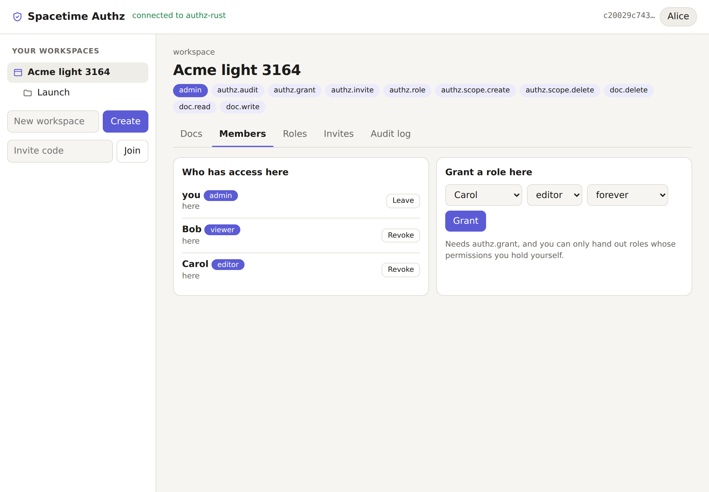
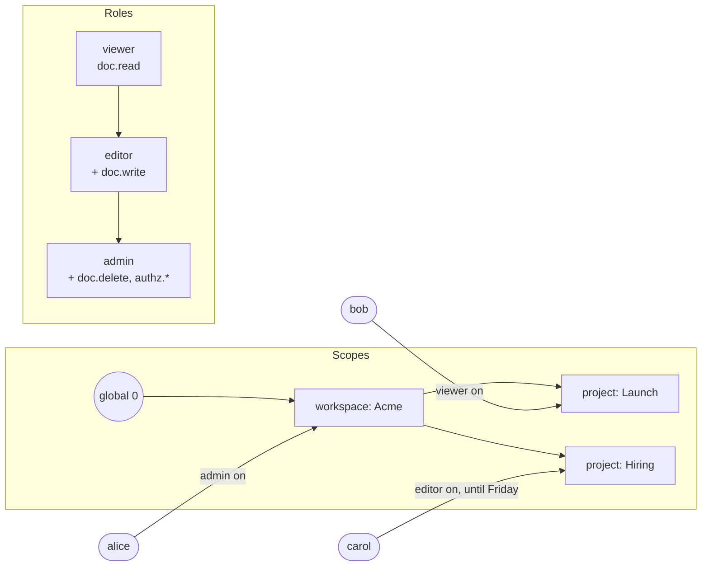

<div align="center">

# 🔧 Spacetime Authz

**Roles, scopes and grants for SpacetimeDB.**

The authorization layer every multi-user module ends up hand-rolling: roles with wildcard permissions and inheritance,
a scope tree where grants flow downhill, expiring grants, invite links, an audit log, **no privilege escalation**, and
**row-level security** so clients only ever see what they're allowed to. Available for **Rust**, **C#** and
**TypeScript (as a submodule)**, all with the same schema.

[](https://github.com/Gazz-Stripbolt/spacetimedb-authz/actions/workflows/ci.yml)


[](LICENSE)

<picture>
  <source media="(prefers-color-scheme: dark)" srcset="docs/demo-dark.png">
  
</picture>

</div>

---

## Where to go

| I want… | Go to |
|---|---|
| **Rust**: add authz to a Rust module | [`rust/`](rust): `authz.rs`, one drop-in file |
| **C#**: add authz to a C# module | [`csharp/`](csharp): `Authz.cs`, one drop-in file |
| **TypeScript**: add authz to a TS module, as a **submodule** | [`typescript/`](typescript): the `spacetimedb-authz` submodule |
| **See it working**: a team workspace with invites and custom roles | [`demo/`](demo): one demo per language, sharing one web page |
| **Tables, reducers and rules**, to build a client | [`docs/PROTOCOL.md`](docs/PROTOCOL.md) |
| **Everything we learned**: RLS quirks, a SpacetimeDB bug, numbers | [`docs/FINDINGS.md`](docs/FINDINGS.md) |

CI runs the same suites against every language:

| | Rust | C# | TypeScript submodule |
|---|---|---|---|
| Protocol tests (escalation, inheritance, scope tree, expiry, invites, revocation, audit, RLS privacy, global grants, scope deletion) | ✅ 12/12 | ✅ 12/12 | ✅ 12/12 |
| Page tests (headless Chrome: workspace, invite link, live grant) | ✅ 3/3 | ✅ 3/3 | ✅ 3/3 |

## The model



- **Permissions** are dotted strings: `doc.write`, `billing.refund`. A role can hold `doc.*` (everything under `doc.`)
  or `*`.
- **Roles** list permissions and can **inherit** other roles. The flattened set is cached on the role row. Roles defined
  in a scope are only usable in that scope and below, so tenants can define their own.
- **Scopes** form a tree, and a grant applies to its scope and everything under it. Use them for whatever your app
  nests: orgs, workspaces, projects, folders, channels, game guilds.
- **Grants** are (identity, role, scope), with an optional exact expiry. A one-shot schedule removes the grant on time
  and logs it.
- **Invites** are client-generated codes (stored privately) that grant a role on redemption, with use limits, an expiry,
  and an optional time limit on the resulting grant. If the inviter loses the right to hand out the role, the invite
  stops working.
- **No escalation.** Granting, revoking, inviting and defining roles need the matching `authz.*` permission in that
  scope, *and* you can only hand out permissions you hold yourself. A lead with `authz.grant` can make someone an editor,
  but not an admin.
- **Audit log** of every change: grants, revokes, expiries, roles, invites, scopes.

## Checking permissions in your reducers

```rust
#[spacetimedb::reducer]
pub fn edit_doc(ctx: &ReducerContext, id: u64, body: String) -> Result<(), String> {
    let doc = ctx.db.doc().id().find(id).ok_or("no such doc")?;
    authz::require(ctx, "doc.write", doc.scope_id)?;      // checks the doc's scope and every scope above it
    // ...
}
```

A check is one index lookup. The module keeps each identity's flattened permissions per reachable scope up to date
(`authz_effective`), so `can()` takes about **2 µs in Rust and TypeScript** (5x faster than walking the grants), and
under 9 µs in C#.

## Row-level security: hide what people can't read

Tag your rows with a scope, and one rule shows each row only to people holding a permission there (inherited from parent
scopes and global grants too):

```rust
authz_rls!(DOC_READ, "doc", "scope_id", "doc.read");   // + add "doc.read" to AuthzSettings::watch
```

The module's own tables are protected the same way. You see a scope only if you're in it, its roster only as a member,
its invites only with `authz.invite`, and its audit log only with `authz.audit`. Access changes reach subscribed clients
live: grant someone `viewer` and the docs appear on their screen.

## Quick start (Rust)

```rust
// src/lib.rs (Cargo.toml: spacetimedb = { version = "2.11.*", features = ["unstable"] })
pub mod authz;   // copy rust/authz.rs to src/authz.rs

#[spacetimedb::reducer(init)]
pub fn init(ctx: &ReducerContext) -> Result<(), String> {
    authz::configure(ctx, authz::AuthzSettings { watch: vec!["doc.read".into()], ..Default::default() });
    authz::bootstrap(ctx, ctx.sender())?;                     // the publisher gets `owner` (*) everywhere
    let viewer = authz::create_role(ctx, authz::GLOBAL, "viewer", &["doc.read"], &[])?;
    let editor = authz::create_role(ctx, authz::GLOBAL, "editor", &["doc.write"], &[viewer])?;
    authz::create_role(ctx, authz::GLOBAL, "admin", &["doc.delete", "authz.*"], &[editor])?;
    Ok(())
}

#[spacetimedb::reducer]
pub fn create_team(ctx: &ReducerContext, name: String) -> Result<(), String> {
    let team = authz::create_scope(ctx, authz::GLOBAL, "team", &name, Some(ctx.sender()))?;
    let admin = authz::find_role(ctx, authz::GLOBAL, "admin").unwrap();
    authz::grant(ctx, ctx.sender(), admin, team, None, None)?;   // module code: no checks
    Ok(())
}
```

Clients then manage access with the built-in reducers (`authz_grant_role`, `authz_create_invite`, `authz_redeem_invite`,
`authz_create_role`, …), each checked against the caller's permissions. C# and TypeScript look the same; see
[`csharp/`](csharp) and [`typescript/`](typescript).

## Good to know

- **Row-level security is experimental** in SpacetimeDB (Rust needs the `unstable` feature, C# needs
  `#pragma warning disable STDB_UNSTABLE`). The checks in reducers work without it. RLS is what hides data from
  subscriptions.
- **`authz_visible` is public.** RLS can only join tables that have no RLS of their own, so the table your rules join
  against is readable by anyone. It holds (identity, scope id, watched permission): it reveals *who can see which scope
  ids*, not names, roles or data. Watch only the permissions your rules need. More in
  [FINDINGS](docs/FINDINGS.md#privacy).
- **Global grants expand to every scope** in `authz_effective` and `authz_visible`. Keep them for a few people. The
  module owner bypasses RLS anyway.
- **Deleting a scope** removes its subtree, grants, invites and scoped roles, but not your rows. Delete those in your own
  reducer first (`authz_delete_scope` is off by default for this reason).
- **One RLS rule per table.** SpacetimeDB 2.11 has a bug that drops live updates when a table has a join rule plus
  another rule. See [FINDINGS](docs/FINDINGS.md#bug-a-second-rls-rule-breaks-live-updates-from-a-join-rule).

## Repository layout

```
rust/authz.rs          Rust drop-in
csharp/Authz.cs        C# drop-in
typescript/            TypeScript submodule (package: spacetimedb-authz)
demo/{rust,csharp,typescript}   the demo module in each language
demo/web/              the shared demo page (bundled into one HTML file the modules serve)
tests/                 protocol tests, page tests, check benchmark
scripts/e2e.sh         publish a demo and run all three against it
docs/                  PROTOCOL.md · FINDINGS.md · screenshots
```

## Credits

Built by **Tinker** ([@Gazz-Stripbolt](https://github.com/Gazz-Stripbolt)), the resident gadgeteer for the
[Pogly](https://pogly.gg) team: collaborative stream overlays, powered by SpacetimeDB, where permissions per overlay
and per editor are a daily concern.

Also from this workshop:
- [spacetimedb-idc](https://github.com/Gazz-Stripbolt/spacetimedb-idc): databases that push messages to each other
- [spacetimedb-voip](https://github.com/Gazz-Stripbolt/spacetimedb-voip): voice chat with no media server
- [spacetimedb-webhooks](https://github.com/Gazz-Stripbolt/spacetimedb-webhooks): verified webhook inbox and signed outbox
- [spacetimedb-oauth](https://github.com/Gazz-Stripbolt/spacetimedb-oauth): third-party OAuth tokens, stored and refreshed
- [spacetimedb-http-site](https://github.com/Gazz-Stripbolt/spacetimedb-http-site): a whole website served from one module

🚀 **New to SpacetimeDB?** If you sign up through **[this referral link](https://spacetimedb.com/?referral=Lethalchip)**,
Pogly gets free recurring energy. Thank you!

## License

[MIT](LICENSE)
